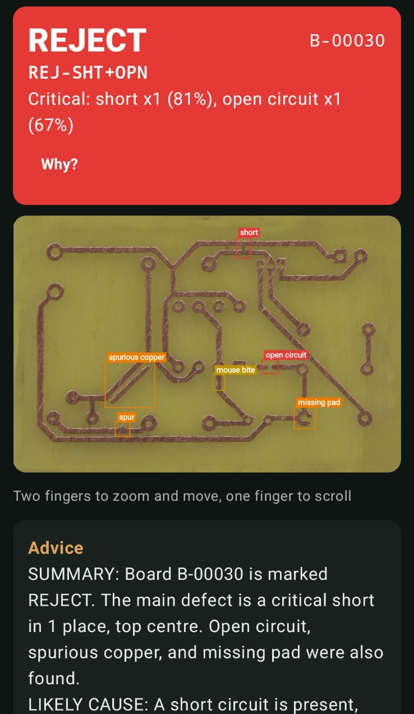
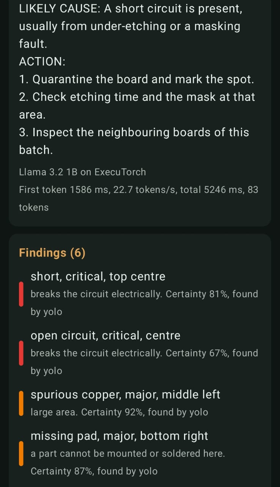
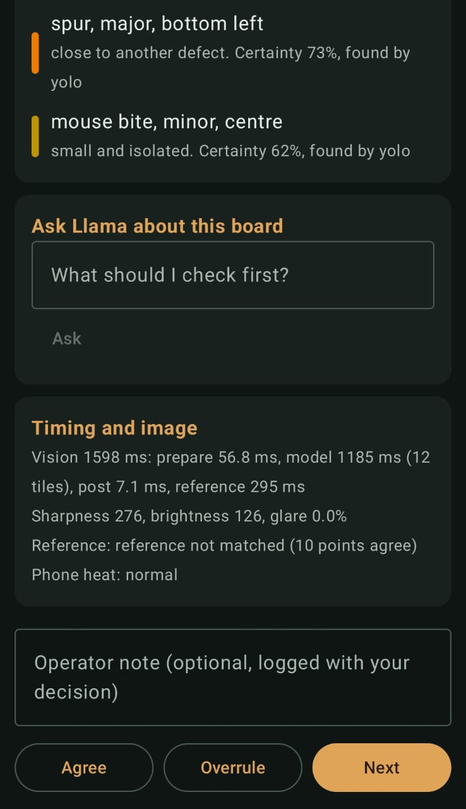
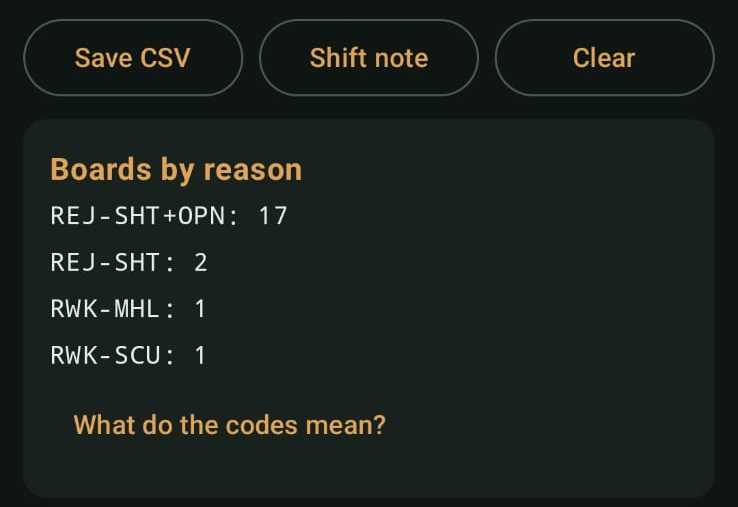
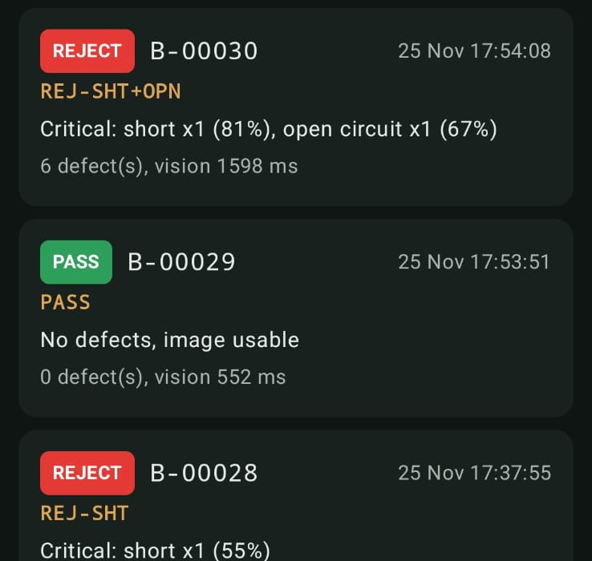
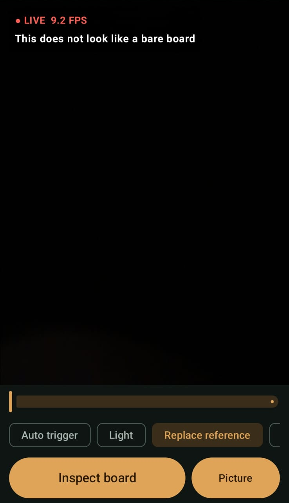

# BoardSight

An offline Android app that inspects bare printed circuit boards. A phone camera finds defects, fixed rules set the severity and verdict, and Llama 3.2 1B explains the result through ExecuTorch. Everything runs on one Arm phone with the internet off.

Made for the Bharat AI SoC Challenge, Problem Statement 5: real-time industrial defect detection and quality control assistant.

**Final project report:** [docs/BoardSight_Report.pdf](docs/BoardSight_Report.pdf)

## Preview

| Result | Llama's advice | Findings, questions and timing |
|---|---|---|
|  |  |  |

| Boards by reason | Inspection log | Board check, live |
|---|---|---|
|  |  |  |

Screenshots from a Samsung Galaxy A57. Board image: PCB-Defect, doi:10.17632/vdj74sngvn.1, CC BY 4.0, opened with Picture.

## How it works

1. **Camera:** live whole-frame preview, then a full photo.
2. **Checks:** blur, light and glare, and whether the picture looks like a bare board.
3. **Detector:** YOLO11n in ONNX Runtime finds 8 defect types in 640-pixel tiles.
4. **Reference board (optional):** aligned and compared with OpenCV.
5. **Rules:** severity and PASS, REVIEW, REWORK, REJECT or RETAKE, each with a reason code.
6. **Llama 3.2 1B (ExecuTorch):** writes a summary, likely cause and steps from the structured findings. An audit rejects replies that contradict them, and built-in text is shown instead, labelled as not from Llama.
7. **Log:** SQLite with reasons, advice, timings and operator decisions. CSV export.

Also included: guided second look, process-drift map, shift notes, questions to Llama, and an on-device benchmark.

## Install the app

Needs an Android 9 or later phone with a 64-bit Arm processor and 8 GB RAM. Tested on a Samsung Galaxy A57.

1. Download `BoardSight.apk` from this repository's **Releases** page and install it.
2. Download these two files from [Llama-3.2-1B-Instruct-SpinQuant_INT4_EO8-ET](https://huggingface.co/executorch-community/Llama-3.2-1B-Instruct-SpinQuant_INT4_EO8-ET). Using them means accepting the Llama 3.2 Community License.

| File | SHA-256 |
|---|---|
| `Llama-3.2-1B-Instruct-SpinQuant_INT4_EO8.pte` | `8715cdba9e91f6bede00cc5f2d6b12397b95225da5630c4972a8da03001cda3b` |
| `tokenizer.model` | `82e9d31979e92ab929cd544440f129d9ecd797b69e327f80f17e1c50d5551b55` |

3. Copy both to the phone. In the app, open **Setup > Choose files** and select both.
4. Turn on airplane mode and use the app. Its only permission is the camera.

**Try it without a board:** tap **Conveyor demo**, or print `demo/demo_sheets.pdf`.

## Build from source

Needs JDK 17 and the Android SDK (platform 36, build-tools 36.0.0). Set `ANDROID_HOME`, then:

```
cd android
./gradlew :app:testDebugUnitTest :app:assembleRelease
```

The APK appears in `android/app/build/outputs/apk/release/`. It is signed with your own debug key, so it cannot update an APK signed by someone else.

## Reproduce the results

Used: Python 3.13, PyTorch 2.11.0 (CUDA 12.8), Ultralytics 8.4.218, one RTX 4060 Laptop GPU.

```
pip install -r training/requirements.txt
```

Put the data in `data/`:

| Folder | Source |
|---|---|
| `data/DeepPCB/DeepPCB-master` | [DeepPCB](https://github.com/tangsanli5201/DeepPCB), unzipped |
| `data/PCB_Defect/PCB_Defect` | [PCB-Defect](https://data.mendeley.com/datasets/vdj74sngvn/1), unzipped |
| `data/DsPCBSDplus` | [DsPCBSD+](https://doi.org/10.6084/m9.figshare.24970329), unzipped |
| `data/pku` | `python training/download_pku.py --out data/pku` |

```
cd training
python find_duplicates.py --pcbdefect ../data/PCB_Defect/PCB_Defect --out ../data/pairs.json
python prepare_data.py --data ../data --out ../data/yolo --pairs ../data/pairs.json
python train.py --data ../data/yolo/pcb.yaml --project ../runs --epochs 45
python export_app.py --weights ../runs/pcb/weights/best.pt --tests ../data/yolo/tests.json --assets ../android/app/src/main/assets
python add_board_check.py --model ../android/app/src/main/assets/pcb_yolo.onnx --params board_check.json
python evaluate_app.py --tests ../data/yolo/tests.json
```

To skip training, use `models/pcb_yolo11n.pt` as `--weights`. The seed is fixed, but the original run was resumed once after a crash, so a fresh run will not match exactly. `board_check.json` was fitted for the supplied weights; after retraining, turn **Setup > Board check** off or refit it.

## Accuracy on held-out images

Measured on a PC with the app's tiling, merging and 0.45 threshold (IoU > 0.33). Settings were chosen on validation images only.

| Test set | Images | Precision | Recall | F1 |
|---|---|---|---|---|
| PCB-Defect, real etched boards | 51 | 0.850 | 0.889 | 0.869 |
| PKU, board photos with edited-in defects | 152 | 0.987 | 0.984 | 0.986 |
| DeepPCB | 250 | 0.928 | 0.958 | 0.943 |
| DsPCBSD+, factory close-ups | 62 | 0.962 | 0.547 | 0.697 |

A false alarm appeared on 16.8% of 250 clean DeepPCB images. The board check refused none of 611 defective-board images and 1.6% of 500 clean DeepPCB images. Trained and tested on other images, it refused 91% of 101 non-board pictures.

PCB-Defect and PKU are split by board design. DeepPCB's official split shares board groups between training and test, so its score is optimistic. Phone camera accuracy is lower than these figures.

## Measured on the phone

BoardSight 1.7 on a Samsung Galaxy A57 (SM-A576B), unplugged. Full output: `docs/benchmark_galaxy_a57.json`.

| Measure | Result |
|---|---|
| Detector, per tile | 95 ms (10.5 FPS) |
| Full etched-board image, median | 1.36 s |
| Llama load | 2.7 s |
| Llama time to first token | 1.71 to 1.86 s |
| Llama generation | 23.3 to 23.5 tokens/s |
| Llama total reply | 4.6 to 5.3 s |
| Memory with Llama | 1423 MB, peak 1670 MB |
| Power, whole phone | 4.6 W, approximate |
| F1, PCB-Defect subset (189 defects) | 0.846 |
| F1, DeepPCB subset (312 defects) | 0.956 |
| F1, DsPCBSD+ subset (135 defects) | 0.673 |

## Why these models on the edge

Detector options measured on the same laptop CPU (4 threads, 640 x 640, ONNX Runtime). Only YOLO11n was trained for this project; the rows show what the larger ones would cost.

| Detector | Parameters (M) | GFLOPs | File (MB) | Time per tile (ms) |
|---|---|---|---|---|
| **YOLO11n (used)** | 2.62 | 6.7 | 10.7 | **28** |
| YOLOv8n | 3.16 | 8.9 | 12.8 | 32 |
| YOLO11s | 9.46 | 21.8 | 38.0 | 78 |
| YOLO11m | 20.11 | 68.6 | 80.6 | 227 |
| YOLO11l | 25.37 | 87.9 | 101.6 | 294 |

Llama 3.2 1B figures published by Meta, measured on a OnePlus 12 with ExecuTorch:

| Llama 3.2 1B | Decode (tokens/s) | First token (s) | File (MB) | Memory (MB) |
|---|---|---|---|---|
| BF16, unquantized | 19.2 | 1.0 | 2358 | 3185 |
| **SpinQuant INT4 (used)** | **50.2** | **0.3** | **1083** | **1921** |

What each change did to F1 on the 51 held-out etched boards:

| Step | F1 |
|---|---|
| First model, YOLOv8n trained on DeepPCB only (threshold 0.25) | 0.00 |
| YOLO11n trained on four datasets (threshold 0.35) | 0.80 |
| Plus tile merging and threshold 0.45 | 0.87 |

## Where it works best

- **Bare boards** before parts are fitted, which is where these defects are cheapest to fix.
- **One board filling the frame**, in focus and in even light, on a plain background.
- **Real boards or paper prints.** Screens add their own pixel pattern, so open image files with **Picture** instead.
- **Black-and-white inspection scans** are best opened directly with **Picture** rather than photographed.
- **A clean reference board** gives the steadiest results, because the app compares every scan with it.
- **Standard track widths.** Very fine hairline tracks benefit from a closer photo.
- **Teamwork with an operator:** unsure cases go to REVIEW, and people can overrule any verdict. Electrical testing remains the final check.

Next steps: boards with components, more factory images, and training on photos from the target line.

## Folders

| Folder | Contents |
|---|---|
| `android/` | The app |
| `training/` | Data preparation, training, evaluation and export |
| `models/` | Trained detector weights |
| `desktop/` | Simpler Python version for Linux or Windows; not all app features |
| `demo/` | Printable test sheets and their known defects |

## Licence

AGPL-3.0, because the detector is made with Ultralytics YOLO. See `LICENSE` and `THIRD_PARTY_NOTICES.md`. Llama is under its own licence.
